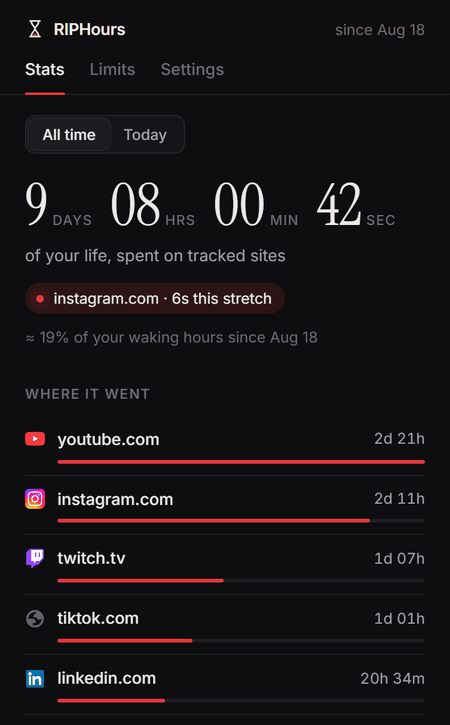
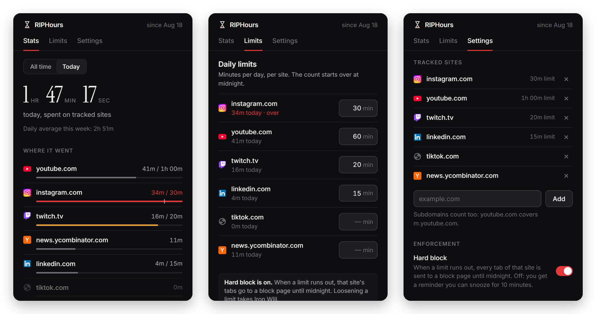
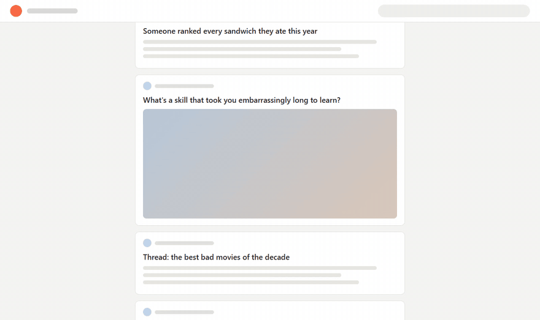
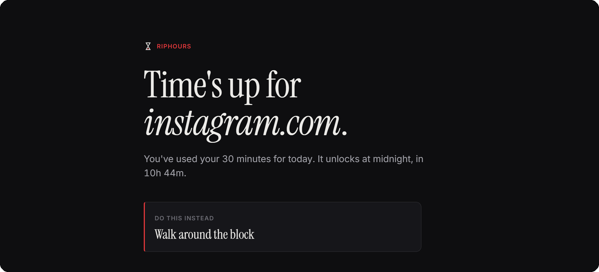
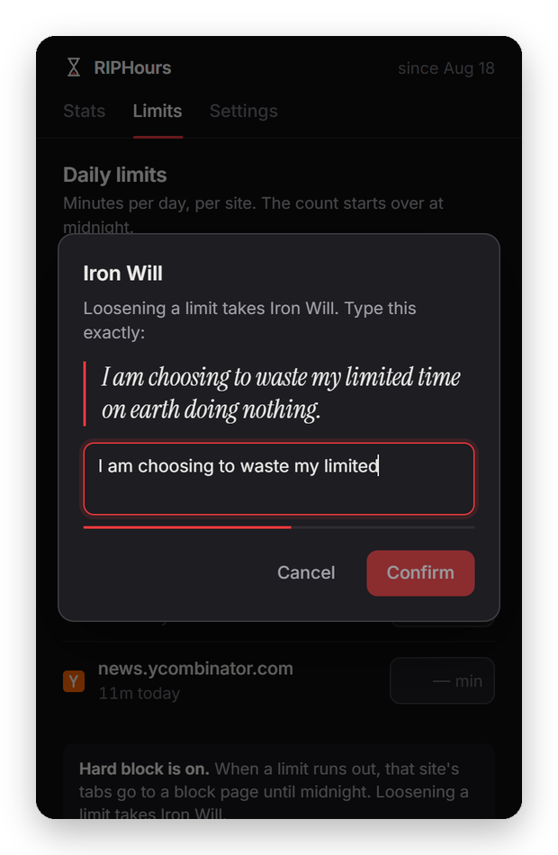
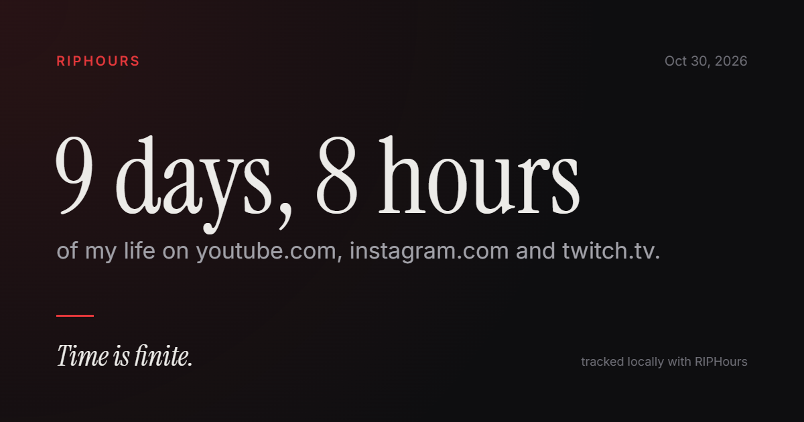
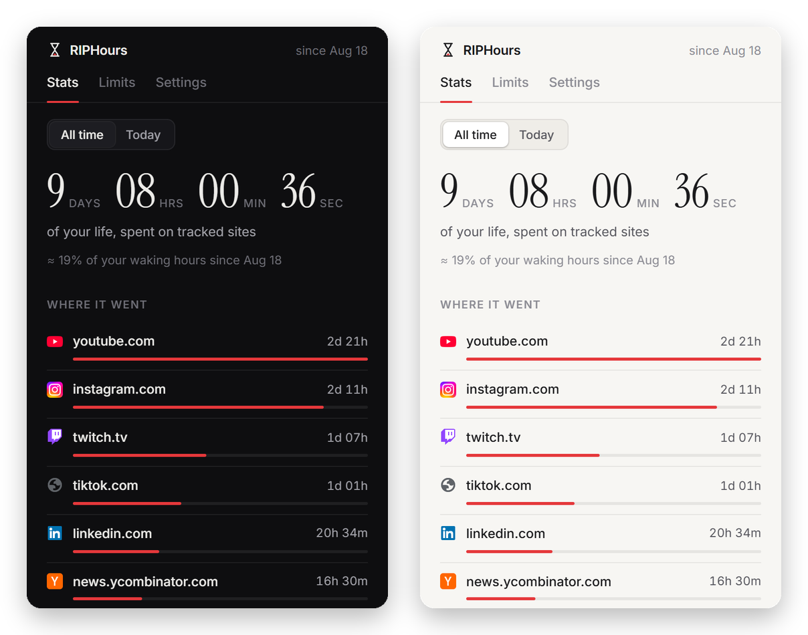

<p align="center">
  
</p>

<h1 align="center">RIPHours</h1>

<p align="center">
  A Chrome extension that counts the time you spend on the sites you pick,<br>
  and shows it as what it is: days of your life.
</p>

---

Screen-time tools usually report a number like "2h 14m" and move on. RIPHours keeps the running total since the day you installed it, so after a few months the counter reads *9 days, 8 hours*. Then it puts limits on those sites, and they actually hold.

Everything stays in your browser. There is no server and no account.

## What it does

- **Counts time you were actually there.** A site's clock runs only while its tab is in front, the window has focus, and you've touched the page in the last minute. Leave a tab open and walk away, and it stops.
- **Counts video too.** An unmuted video or audio track playing on a tracked site keeps the clock running without input, so an hour on YouTube is recorded as an hour.
- **Enforces limits.** Give a site a daily limit. With hard block on, every tab of that site goes to a block page the moment the limit runs out, and stays there until midnight.
- **Makes loosening a limit tedious on purpose.** Raising a limit, removing one or turning off hard block means typing *"I am choosing to waste my limited time on earth doing nothing."* by hand. Pasting is disabled.
- **Focus Surge.** One button blocks every tracked site for 25 minutes.

## A closer look

<p align="center">
  
</p>

**Stats** shows the total for all time or for today, which site is being counted right now, where the time went, and the last seven days. In the Today view each bar fills toward that site's limit: it turns amber at 75% and red once you're over.

**Limits** takes minutes per site. Tightening a limit applies immediately. Loosening one goes through Iron Will.

**Settings** holds the site list, hard block, notifications, the theme, and import and export.

### When a limit runs out

With hard block off, you get a reminder instead of a wall. The page is paused and dimmed until you close the tab or take ten more minutes, and the reminder comes back when they're up.

<p align="center">
  
</p>

With hard block on, the site's tabs go here instead, including tabs in the background and any new ones you open:

<p align="center">
  
</p>

"Do this instead" picks a random line from a list you write. Once the block lifts, at midnight or when a Focus Surge ends, the page offers a link back to where you were.

### Iron Will

<p align="center">
  
</p>

Case and extra spaces don't matter, but every word does. The bar under the field shows how far you've typed correctly.

### Share card

<p align="center">
  
</p>

Drawn on a canvas in the popup, at 1200×630. You can copy it to the clipboard or save it as a PNG.

### Light, dark, or whatever your system says

<p align="center">
  
</p>

Six accent colors. The toolbar badge follows the accent you pick.

## How time is counted

The service worker checks which tab is active in the focused window. If that tab is on a tracked site, it adds time once a second. A small script that runs only on tracked sites reports activity every 15 seconds while the page is visible and either you've used it in the last minute or unmuted media is playing.

Credit stops 60 seconds after the last reported activity, and switching to a tab counts as activity. Nothing past that minute is credited later, even if the computer slept or Chrome shut down the worker.

Days follow your local time zone and roll over at local midnight. A subdomain counts toward its parent site, so `m.youtube.com` counts as `youtube.com`. Incognito windows are never counted.

The toolbar badge shows today's total. You also get a notification after each 30 minutes of unbroken time on tracked sites, and a recap at 9 PM if the day added up to more than a minute. Both can be turned off.

## Install

RIPHours isn't in the Chrome Web Store. To load it:

1. Download or clone this repository.
2. Open `chrome://extensions` and turn on **Developer mode**.
3. Click **Load unpacked** and select the `extension` folder.
4. Pin it from the puzzle-piece menu so the badge is visible.

It needs Chrome 120 or later. Other Chromium browsers such as Edge and Brave load unpacked extensions the same way, though it's only tested in Chrome.

On first run you pick which sites to track. reddit.com, x.com, youtube.com, instagram.com, tiktok.com and facebook.com are preselected. You can add any site later from Settings, or by right-clicking a page and choosing **Track this site in RIPHours**.

## Privacy

- Usage time is stored in `chrome.storage.local` on the device where it happened. It is never sent anywhere.
- Only the domain and seconds per day are recorded: no URLs, page titles or content.
- Your tracked sites, limits and settings sync between computers through Chrome Sync, if you have it on. **Usage time does not sync.** Each computer keeps its own count.
- Incognito is never counted. If you allow the extension in incognito, blocks still apply there.

Full text: [PRIVACY_POLICY.md](extension/PRIVACY_POLICY.md).

## Permissions

| Permission | Why |
| --- | --- |
| `tabs` | Read the active tab's address to know which site you're on, and send blocked tabs to the block page. |
| `storage` | Keep usage and settings locally, and sync settings through Chrome Sync. |
| `alarms` | A 30-second heartbeat for midnight rollover and the nightly recap, and a timer for the end of a Focus Surge. |
| `notifications` | Limit, break, recap and Focus Surge notifications. |
| `contextMenus` | The right-click "Track this site in RIPHours" item. |
| `offscreen` | Service workers can't play audio. An offscreen document plays the alert sound. |
| `scripting` | Register the activity script for tracked sites only, and add it to tabs that are already open when you add a site. |
| `favicon` | Show site icons in the popup from Chrome's own icon cache, without fetching anything. |
| Access to all sites | Lets the activity script run on, and blocks apply to, whichever sites you choose to track. It doesn't run anywhere else. |

## Your data

Settings → Data has:

- **Export CSV**: minutes per site per day, one row per date. Ready for a spreadsheet.
- **Export JSON**: a complete backup.
- **Import JSON**: restores a backup, including one made by an older version. You confirm before it replaces anything.
- **Erase usage history**: wipes the recorded time and keeps your sites and settings. You have to type RESET to confirm.

Daily history is kept for 120 days. All-time totals are kept for as long as the extension is installed. If you stop tracking a site, its history stays, and adding it back brings the numbers back.

## Project layout

```
extension/
  manifest.json
  background/
    worker.js          tracking, limits, blocking, badge, sync, notifications
    offscreen.*        plays the alert sound
  content/tracker.js   activity reports and the soft-limit overlay (tracked sites only)
  popup/               popup.html, popup.js, popup.css, share-card.js
  pages/blocked/       block page
  pages/welcome/       first-run page
  shared/              core.js (schema, migration, formatting), theme.css, page.css
  fonts/               Inter and Instrument Serif, with their licenses
```

There's no build step. The files in `extension/` are exactly what Chrome loads.

## Credits

Type is set in [Inter](https://rsms.me/inter/) and [Instrument Serif](https://github.com/Instrument/instrument-serif), both under the SIL Open Font License. The license texts are in `extension/fonts/`.
